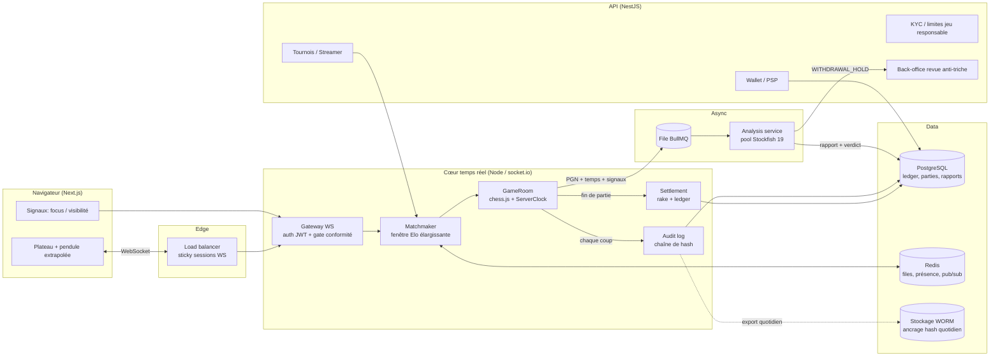
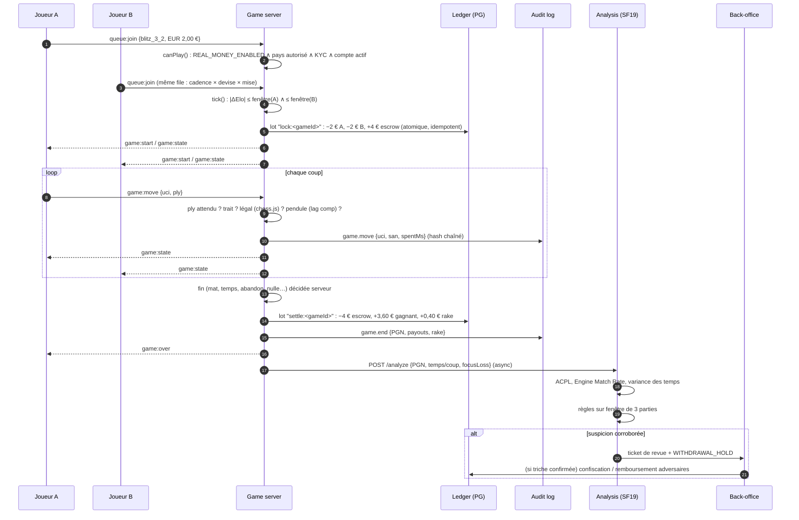

# ChessArena — Spécification d'architecture système (MVP / Bêta, 500 h)

> Statut : v0.1 — 25/10/2026 · Cible : 10 000 MPU France (Pre-Seed), puis international.
> Le code de ce dépôt implémente le chemin critique : **Matchmaking → Partie → Règlement (rake) → Audit → Analyse anti-triche**.

---

## 0. Décisions d'architecture (ADR résumées)

| # | Décision | Pourquoi | Écart vs fiche initiale |
|---|----------|----------|-------------------------|
| ADR-1 | **TypeScript partout** (Next.js + Node/socket.io), pas de Go au MVP | Une seule stack = un seul profil à recruter, types partagés front/back (`packages/shared`). Un process Node tient plusieurs milliers de sockets ; 10 k MPU ≈ 300–1 000 parties simultanées au pic. Go ne se justifie qu'au-delà. | Go écarté pour le MVP |
| ADR-2 | **Serveur de jeu en socket.io "nu"**, NestJS seulement pour l'API REST (wallet, tournois, admin) | La boucle temps réel doit rester minimale et lisible ; l'injection de dépendances NestJS n'apporte rien dans le chemin chaud. | Précision |
| ADR-3 | **Légalité des coups : `chess.js` côté serveur**, pas Stockfish | Un moteur évalue, il n'arbitre pas. chess.js valide un coup en microsecondes ; Stockfish coûterait des millisecondes de CPU par coup. | **Corrigé** |
| ADR-4 | **Aucun Stockfish côté client pendant une partie** | Charger le moteur WASM dans le navigateur d'un joueur = lui fournir l'outil de triche. Analyse côté client uniquement **après** la partie (page "revue"). | **Corrigé** |
| ADR-5 | Stockfish 19 **natif** côté serveur, version épinglée | Binaire natif nettement plus rapide que WASM ; version figée pour qu'un rapport anti-triche soit rejouable à l'identique (preuve en cas de litige). | Précision |
| ADR-6 | **Argent = entiers en centimes + grand livre en partie double** | Aucun float ; un solde n'est jamais modifié, il est la somme d'écritures ; chaque lot est équilibré et idempotent. | Ajout |
| ADR-7 | **Sanction auto = blocage des retraits**, pas gel du compte | Réduit l'impact des faux positifs tout en empêchant l'argent de sortir ; décision finale humaine. | **Modifié** |
| ADR-8 | **Pendule autoritaire serveur + compensation de lag** | "< 50 ms" de bout en bout n'est pas garantissable sur Internet (mobile 4G : 60–150 ms RTT). On garantit plutôt : traitement serveur < 5 ms p99, et compensation du lag plafonnée à 250 ms par coup. | **Reformulé** |
| ADR-9 | **Interrupteur juridictionnel** `REAL_MONEY_ENABLED` + liste de pays | Le mode argent réel est désactivé par défaut et ne s'active que pays par pays, après validation juridique (voir §6). | Ajout |

---

## 1. Vue d'ensemble



## 2. Flux détaillé : Matchmaking ➔ Jeu ➔ Analyse ➔ Règlement



### 2.1 Règles du chemin chaud (implémentées dans `apps/game-server`)

1. **Un coup est accepté seulement si** : la partie existe, l'émetteur est assis, c'est son trait, `ply` correspond (anti double-envoi / rejeu), format UCI valide, coup légal, drapeau non tombé.
2. **Pendule** : les deux premiers demi-coups ne sont pas chronométrés ; chaque camp a 20 s pour les jouer, sinon partie **annulée et remboursée sans rake**.
3. **Déconnexion** : 30 s de grâce, puis défaite par abandon (annulation si < 2 demi-coups).
4. **Chute du drapeau** : nulle si l'adversaire n'a que son roi (règle FIDE simplifiée).
5. **Règlement** : déclenché une seule fois, idempotent (`settle:<gameId>`), invariant `Σ gains + rake = pot` vérifié avant écriture.

### 2.2 Rake (fonctions pures, `settlement/rake.ts`, testées)

| Cas | Pot | Rake 10 % | Redistribution |
|-----|-----|-----------|----------------|
| Duel 2 € vs 2 €, victoire | 4,00 € | 0,40 € | 3,60 € au gagnant |
| Duel, nulle | 4,00 € | 0,40 € | 1,80 € chacun (centime impair → Blancs) |
| Duel annulé (< 2 demi-coups) | 4,00 € | **0** | remboursement intégral |
| Sit & Go 8 × 5 € + 20 € sponsor | 60,00 € | 4,00 € (sur les 40 € d'inscriptions seulement) | 65 % / 35 % de 56 € |

Arrondi : `floor` → l'arrondi profite toujours au joueur.

## 3. Anti-triche v1

### 3.1 Métriques (service `services/analysis`)
- **ACPL** : perte moyenne en centipions par coup, à profondeur fixe, évals bornées à ±1000.
- **Engine Match Rate** : part des coups identiques au meilleur coup du moteur.
- **Variance des temps de réflexion** : un humain varie, un relais moteur est souvent régulier.
- **Pertes de focus** : signal faible (double écran, notifications…), jamais suffisant seul.

**Filtres indispensables** (sinon faux positifs massifs) : 16 premiers demi-coups exclus (théorie), positions déjà décidées (|éval| > 5 pions) exclues, coups forcés exclus, minimum 15 coups analysés par partie.

### 3.2 Règle de décision
| Condition | Verdict | Action |
|-----------|---------|--------|
| < 3 parties avec ≥ 15 coups analysés | CLEAN | — |
| ACPL < 10 sur 3 parties **+** joueur < 2000 **+** score ≥ 60 (au moins un 2e signal : match ≥ 80 %, focus, temps réguliers) | WITHDRAWAL_HOLD | retraits EUR bloqués + ticket de revue humaine |
| score ≥ 40 | WATCH | analyse depth 18–20 sur toutes ses parties suivantes |

La règle initiale "ACPL < 10 sur 3 parties → gel" est conservée comme **déclencheur**, mais doit être **corroborée** : en bullet, 3 parties courtes contre des adversaires faibles produisent naturellement des ACPL très bas.

**Calibration (Sprint 3)** : passer le pipeline sur quelques dizaines de milliers de parties humaines publiques de la base Lichess, par tranche Elo et cadence, pour mesurer le taux de faux positifs avant d'activer le moindre blocage.

### 3.3 Coût CPU et triage
Depth 18 ≈ 10–30 s CPU par partie. À 10 k MPU (~200 k parties/mois) : ~1 000–1 700 h CPU/mois si tout est analysé à fond. D'où : **depth 12 pour tout le monde, depth 18–20 pour les parties EUR et les joueurs en WATCH**.

## 4. Séparation Play Money / Real Money

- Devise portée par **chaque** écriture comptable ; contrainte SQL : un compte `user:<id>:EUR` ne peut porter que des EUR.
- Files de matchmaking distinctes par `cadence × devise × mise` : un joueur PLAY ne rencontre jamais un joueur EUR.
- Le droit de miser en EUR est calculé **côté serveur à chaque connexion** (Sprint 4, `net/geoFilter.ts`) : mode de session `REAL_MONEY` seulement si kill-switch ON (base ∧ environnement) ∧ pays de l'IP autorisé ∧ résidence KYC autorisée ∧ pas d'auto-exclusion. KYC, état du compte et résidence sont relus en base (jamais pris dans le JWT).
- Limites de dépôt et de mise, auto-exclusion : vérifiées **dans la transaction comptable** (`PgLedger` → `LimitsService.ledgerPolicy`), donc impossibles à contourner par une course ou un chemin de code oublié.
- Les jetons PLAY n'ont aucune valeur, ne sont **jamais convertibles** en EUR (sinon on recrée un jeu d'argent).

## 5. Journalisation inaltérable

- Chaque coup, fin de partie, écriture comptable et décision anti-triche → entrée `audit_log` avec `prev_hash` / `hash` (SHA-256, JSON canonique).
- Triggers SQL interdisant UPDATE/DELETE sur `audit_log`, `ledger_entries`, `ledger_transactions` ; rôle applicatif sans `TRUNCATE`.
- Ancrage externe quotidien du dernier hash sur stockage WORM (ex. S3 Object Lock en mode compliance).
- `verifyChain()` permet à un auditeur de prouver qu'aucune ligne n'a été modifiée (testé : modifier un coup casse la chaîne).

## 6. ⚠ Risque juridique bloquant (à traiter avant toute ligne de code "Real Money")

En droit français, l'interdiction des jeux d'argent (art. L320-1 du Code de la sécurité intérieure) **couvre explicitement les jeux reposant sur le savoir-faire des joueurs** dès lors qu'un sacrifice financier est exigé. Les agréments en ligne délivrés par l'ANJ couvrent les paris sportifs, les paris hippiques et le poker — pas les compétitions d'échecs à buy-in. Un tournoi d'échecs payant avec gains en argent pour des joueurs français est donc, en l'état, très probablement **illicite**, quel que soit le caractère "skill" du jeu.

Mise à jour Sprint 4 : il n'existe toujours pas d'agrément ANJ « skill gaming » ; le régime expérimental JONUM exclut les gains en monnaie ayant cours légal. Le module de conformité applique donc les obligations des opérateurs agréés comme référentiel (voir `docs/SPRINT4.md` §0).

Conséquences d'architecture (déjà intégrées) :
1. `REAL_MONEY_ENABLED=0` par défaut ; activation **pays par pays** (`REAL_MONEY_COUNTRIES`) après avis d'un avocat spécialisé.
2. Le produit France de la bêta doit fonctionner **sans sacrifice financier** : PLAY money, tournois **gratuits dotés** par un streamer/sponsor (dotation non rakée), monétisation par sponsoring, abonnements créateurs, publicité.
3. Le modèle à rake ne s'active que dans des juridictions où le "skill gaming" en argent réel est expressément licite (à cartographier avec un conseil).
4. Prévoir la géolocalisation vérifiée (IP + KYC), l'interdiction aux mineurs, les limites de dépôt et l'auto-exclusion — même si la loi applicable ne les impose pas, les PSP les exigeront.
5. Stripe classe les jeux d'argent parmi les activités soumises à approbation préalable : un PSP spécialisé jeux sera probablement nécessaire.

---

## 7. Structure du dépôt

```
chessarena/
├── package.json                 # workspaces npm (shared, game-server, analysis)
├── tsconfig.base.json           # strict, NodeNext, alias @chessarena/shared
├── docs/
│   └── ARCHITECTURE.md          # ce document
├── packages/
│   └── shared/src/index.ts      # contrats : cadences, protocole WS, types argent, AnalysisRequest
├── apps/
│   ├── game-server/             # ⚡ temps réel (Node + socket.io)
│   │   └── src/
│   │       ├── server.ts        # point d'entrée (lit l'env, démarre la factory)
│   │       ├── app.ts           # gateway WS : factory testable, routage, /health, /metrics
│   │       ├── config.ts        # variables d'env (rake bps, kill-switch argent réel, pays)
│   │       ├── auth.ts          # JWT + canPlay() (mode de session / KYC / état du compte)
│   │       ├── auth/kyc.ts      # S4 : machine d'états KYC, 18+, sanctions/PEP, webhook HMAC
│   │       ├── validation.ts    # type guards des payloads entrants
│   │       ├── net/             # rateLimiter (token bucket), lagTracker (RTT serveur), metrics
│   │       │   └── geoFilter.ts     # S4 : IP → pays (anti-XFF spoofing), mode de session, KillSwitch
│   │       ├── game/
│   │       │   ├── clock.ts         # pendule autoritaire + lag compensation
│   │       │   ├── GameRoom.ts      # une partie : chess.js, ply, fin, abandon, focus
│   │       │   ├── GameManager.ts   # cycle de vie : lock mises → jeu → règlement → analyse
│   │       │   └── GameRoom.test.ts
│   │       ├── matchmaking/
│   │       │   ├── Matchmaker.ts    # files cadence×devise×mise, fenêtre Elo élargissante
│   │       │   └── Matchmaker.test.ts
│   │       ├── rating/elo.ts        # Elo K 40/20/10, règle des 400 points
│   │       ├── persistence/GameRepository.ts  # parties + Elo + historique (1 transaction, idempotent)
│   │       ├── tournaments/         # SitAndGo (moteur KO), TournamentManager (lobby), TournamentStore
│   │       ├── db/                  # migrate.ts (runner), tx.ts (SERIALIZABLE + reprises)
│   │       ├── settlement/
│   │       │   ├── rake.ts          # calcul pur du rake et des gains (invariants)
│   │       │   ├── rake.test.ts
│   │       │   ├── ledger.ts        # partie double : PgLedger SERIALIZABLE (+ policy de conformité) / InMemoryLedger
│   │       │   ├── deposits.ts      # S4 : dépôts idempotents (sandbox)
│   │       │   └── withdrawals.ts   # S3/S4 : retraits, WITHDRAWAL_HOLD, KYC exigé
│   │       ├── fairplay/limits.ts   # S4 : limites de dépôt / mise, auto-exclusion (dans la transaction comptable)
│   │       ├── audit/auditLog.ts    # chaîne SHA-256 : FileAuditLog, PgAuditLog, verifyAuditTable()
│   │       ├── audit/regulatoryExport.ts  # S4 : export signé (SHA-256 + Ed25519), vérification hors ligne
│   │       ├── http/api.ts          # REST : joueur, modération, conformité, webhook KYC
│   │       └── anticheat/analysisClient.ts  # envoi asynchrone vers le service d'analyse
│   │   ├── test/integration.test.ts  # vrai serveur socket.io + vrais clients + JWT
│   │   ├── test/db/                  # suites PostgreSQL réel (ledger, crash SIGKILL, Elo, audit, E2E)
│   │   └── scripts/loadtest.ts       # DoD : 500 parties, p99 < 5 ms
│   ├── api/                     # (S2–S5) NestJS : wallet, PSP, KYC, tournois, admin
│   └── web/                     # Next.js
│       ├── app/play/page.tsx    # page de jeu (plateau, pendules, file d'attente)
│       ├── hooks/useGameSocket.ts   # sync horloge, extrapolation, signaux focus
│       ├── lib/socket.ts
│       └── (S5) app/overlay/[tournamentId]/page.tsx  # overlay OBS (browser source)
├── services/
│   └── analysis/                # 🔍 anti-triche (Node + Stockfish 19 natif)
│       └── src/
│           ├── server.ts        # POST /analyze (202), GET /reports/:id, triage de profondeur
│           ├── uci.ts           # pilote UCI + pool de moteurs (1 process / cœur)
│           ├── metrics.ts       # ACPL, Engine Match Rate, variance des temps (filtres)
│           ├── rules.ts         # verdicts CLEAN / WATCH / WITHDRAWAL_HOLD
│           └── analysis.test.ts
├── db/migrations/001_init.sql   # users/KYC, ledger double, tournois, rapports, audit immuable
└── infra/
    ├── docker-compose.yml       # postgres, redis, analysis, game-server
    └── analysis.Dockerfile      # image avec binaire Stockfish 19 épinglé
```

---

## 8. Plan de sprints — 500 h (5 × 100 h)

Hypothèse : **1 développeur full-stack TypeScript confirmé**. Les heures incluent tests et revue. Chaque sprint se termine par une démo et une "Definition of Done" vérifiable.

### Sprint 1 (h 0–100) — Boucle de jeu jouable — ✅ livré (voir `docs/SPRINT1.md`)
| Tâche | h |
|---|---|
| Monorepo, CI (lint, typecheck, tests), environnements dev/staging | 10 |
| Auth (NextAuth : email magique + Google), émission JWT pour le game-server | 14 |
| Game-server : GameRoom, pendule, reconnexion, abandon, annulation (base fournie) | 22 |
| Front : plateau, prémoves, pendules extrapolées, sons, mobile | 26 |
| Matchmaking 1v1 4 cadences en PLAY (base fournie) | 10 |
| Tests d'intégration 2 clients + test de charge 500 parties simulées | 12 |
| Déploiement staging (1 VM + Postgres managé) | 6 |
**Livrable** : deux inconnus se trouvent et jouent une partie complète en Bullet/Blitz/Rapid en PLAY, avec reconnexion. **DoD** : 0 coup illégal accepté, traitement serveur p99 < 5 ms sur 500 parties simultanées.

### Sprint 2 (h 100–200) — Persistance, Elo, Sit & Go — ✅ livré (voir `docs/SPRINT2.md`)
| Tâche | h |
|---|---|
| Migrations PG, PgLedger, wallet PLAY persistant | 16 |
| Elo par cadence, historique, profil joueur, export PGN | 14 |
| Redis : présence, files de matchmaking partagées, pub/sub (prépare le multi-instance) | 16 |
| Sit & Go 4/6/8 joueurs (inscription, bracket KO, départage, règlement) | 30 |
| Audit log en base + trigger immuable + export WORM | 10 |
| Tests (règlement tournoi, idempotence, crash pendant règlement) | 14 |
**Livrable** : Sit & Go PLAY de bout en bout, gains crédités, tout est rejouable depuis le journal. **DoD** : un kill -9 pendant un règlement ne crée ni ne détruit aucun centime.

### Sprint 3 (h 200–300) — Anti-triche v1 — ✅ livré, calibration réelle à exécuter (voir `docs/SPRINT3.md`)
| Tâche | h |
|---|---|
| Service d'analyse Stockfish 19 natif, pool, file BullMQ durable (base fournie) | 18 |
| Table `anticheat_reports`, historique joueur, verdicts | 10 |
| Calibration sur parties humaines publiques Lichess (taux de faux positifs par Elo/cadence) | 24 |
| Back-office de revue : file triée par score, PGN annoté, graphe d'éval, décision | 26 |
| Signaux front (focus, visibilité), stats de temps de coup | 8 |
| Analyse post-partie côté joueur (Stockfish WASM, **après** la partie uniquement) | 14 |
**Livrable** : chaque partie ≥ 20 demi-coups est analysée en < 2 min ; un admin traite un dossier en < 3 min. **DoD** : taux de faux positif WITHDRAWAL_HOLD mesuré < 0,1 % sur le jeu de calibration.

### Sprint 4 (h 300–400) — Wallet sandbox & conformité "by design" — ✅ livré, périmètre recentré sur KYC / limites / géo-filtre / kill-switch / export signé (voir `docs/SPRINT4.md`)
| Tâche | h |
|---|---|
| API NestJS wallet : dépôts/retraits mockés, `payment_intents`, webhooks idempotents | 22 |
| Interface PSP abstraite (sandbox + adaptateur PSP réel à brancher) | 10 |
| KYC mock (états none → pending → verified), contrôle 18+, géolocalisation | 14 |
| Jeu responsable : limites de dépôt/perte, auto-exclusion, historique de dépenses | 16 |
| Kill-switch juridictionnel, retraits soumis au statut anti-triche | 8 |
| Observabilité (OpenTelemetry, Grafana : latence coups, files, erreurs ledger) | 14 |
| Revue de sécurité (OWASP, rate limiting, rejeu WS, secrets) | 16 |
**Livrable** : parcours complet dépôt → partie → gain → demande de retrait en **sandbox**, bloqué automatiquement en cas de HOLD. **DoD** : rapprochement comptable quotidien (Σ comptes = 0) automatisé et vert.

### Sprint 5 (h 400–500) — Streamers, Arena, bêta
| Tâche | h |
|---|---|
| Dashboard streamer : création de tournoi privé, code d'invitation, dotation, règles | 24 |
| Overlay OBS (page browser source temps réel : classement, partie en vedette) | 16 |
| Arena (appariement continu, points de série) — Swiss reporté si nécessaire | 24 |
| Spectateurs (diffusion avec délai de 15 s pour éviter le "ghosting") | 10 |
| Test de charge 3 000 sockets, correctifs | 12 |
| Bêta fermée : onboarding, feedback, correctifs | 14 |
**Livrable** : un streamer lance un tournoi Arena doté devant sa communauté avec overlay en direct.

**Coupes si retard** (dans cet ordre) : Swiss → spectateurs → analyse post-partie joueur → 6 joueurs en Sit & Go.

---

## 9. Dimensionnement indicatif (10 000 MPU)

| Ressource | Estimation | Configuration |
|-----------|-----------|---------------|
| Parties simultanées au pic | 300–1 000 | 2 instances game-server (redondance), sticky sessions |
| Messages WS | ~2–5 k/s au pic | trivial pour socket.io + Redis adapter |
| Analyse | ~200 k parties/mois | 2–3 machines 16 cœurs avec triage de profondeur |
| PostgreSQL | < 50 Go la 1re année | instance managée + réplica + PITR |

## 10. Démarrage local

```bash
npm install
npm test                                   # rake, matchmaking, partie, analyse
DEV_AUTH=1 npm run dev:game                # :4000 — ledger mémoire, 100 jetons PLAY offerts
STOCKFISH_PATH=$(which stockfish) npm run dev:analysis   # :4100
# ou tout en conteneurs :
docker compose -f infra/docker-compose.yml up
```
