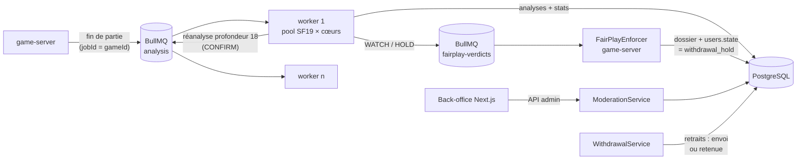

# Sprint 3 — Anti-triche : pipeline BullMQ, WITHDRAWAL_HOLD, back-office, calibration

> 26/10/2026 · DoD (ARCHITECTURE.md §8) : *taux de faux positifs WITHDRAWAL_HOLD < 0,1 % mesuré sur le jeu de calibration.*
> **⚠ DoD partiellement atteinte** : le script de calibration est livré et testé de bout en bout, mais **la mesure sur données Lichess réelles n'a pas pu être faite ici** (voir §4). Tout le reste est livré et testé sur Redis 7, PostgreSQL 16 et Stockfish 19 réels.

## 1. Architecture

- **Le service d'analyse détecte, le game-server applique.** Seul le game-server modifie l'état d'un compte ou l'argent. L'analyse lui envoie des verdicts via une file dédiée.
- **Triage** :
  - profondeur 12 pour les parties PLAY ;
  - profondeur 18 (configurable de 18 à 20) pour les parties EUR et les joueurs sous surveillance.
  - Les parties EUR passent en priorité dans la file.
- **Confirmation avant tout blocage** : si le motif suspect apparaît sur des analyses de triage, les parties de la fenêtre sont réanalysées en profondeur 18. Le blocage n'est décidé que sur ces analyses profondes.
- **Pool de moteurs** : un processus Stockfish mono-thread par cœur, qui fixe aussi la concurrence du worker. Un moteur qui plante ou dépasse son délai est remplacé, et la tâche en cours est rejouée par BullMQ.

## 2. Livrables

| Module | Fichiers | Points clés |
|---|---|---|
| File et worker | `services/analysis/src/{queue,worker,pipeline,server}.ts` | Identifiants de tâche déterministes (une partie n'est mise en file qu'une fois) ; priorités ; 5 tentatives avec backoff ; erreurs définitives sans nouvelle tentative ; échecs conservés 30 jours (file des échecs) ; reprise des tâches d'un worker mort |
| Moteur | `services/analysis/src/uci.ts` | Scores de mat corrects ; délai par évaluation ; remplacement automatique d'un moteur mort ; `STOCKFISH_CMD` pour le binaire natif ou WASM |
| Métriques | `services/analysis/src/metrics.ts` | Perte et coïncidence moteur par coup ; exclusions (16 premiers demi-coups, \|éval\| > 1000, coups forcés) ; variance, écart-type et coefficient de variation des temps ; détail par coup conservé pour le back-office |
| Règle | `services/analysis/src/rules.ts` | HOLD si ACPL < 10 sur chacune des 3 dernières parties éligibles, coïncidence moteur sur l'ensemble des coups ≥ 80 %, Elo < 2000 et analyses en profondeur ≥ 18 ; sinon CONFIRM, WATCH ou CLEAN |
| Retraits | `apps/game-server/src/settlement/withdrawals.ts`, `ledger.ts` (`postWithin`) | Fonds réservés à la demande ; exécution dans une transaction verrouillée ; WITHDRAWAL_HOLD → retenue invisible pour le joueur ; levée de la retenue ; annulation en cas de ban |
| Application des verdicts | `apps/game-server/src/fairplay/FairPlayEnforcer.ts` | Dossier unique par joueur ; la gravité ne redescend jamais automatiquement ; idempotent ; ignore les parties déjà jugées « clean » |
| Arbitrage | `apps/game-server/src/fairplay/ModerationService.ts`, `src/http/api.ts` | `clean` / `watch` / `cheat` ; le ban, les remboursements, la confiscation et la décision sont écrits dans une seule transaction ; décisions append-only et auditées |
| Back-office | `apps/web/app/admin/anticheat/page.tsx`, `components/admin/*` | File des dossiers ; courbe d'éval ; pertes et temps coup par coup ; coups moteur ★ ; gaffes « ?? » ; plateau ; historique ; décision avec motif obligatoire et confirmation pour `cheat` |
| Calibration | `services/analysis/scripts/calibrate.ts`, `src/calibration/*` | Lecture en flux des exports Lichess `.pgn.zst` ; échantillonnage par tranche d'Elo ; analyse parallèle avec reprise ; taux de faux positifs par joueur et par fenêtre ; borne de Clopper-Pearson ; balayage des seuils ; exclusion des tricheurs avérés (`--tos-check`) |
| Schéma | `db/migrations/002_fairplay.sql` | Analyses, statistiques, dossiers, décisions (immuables) ; retraits ; **garde-fous SQL G1 et G2** |

## 3. WITHDRAWAL_HOLD : ce qui est garanti (et testé)

| Garantie | Mécanisme | Test |
|---|---|---|
| Aucun euro ne sort pour un compte bloqué | `processOne()` → `on_hold` | `withdrawals.pg` |
| …même en contournant le code | trigger G1 sur `house:psp-out:*` + trigger G2 sur le statut `sent` | écriture comptable et `UPDATE` SQL directs refusés |
| …même en cas de blocage pendant un envoi | l'exécution verrouille le compte du titulaire ; le blocage attend la fin de l'envoi | blocage mesuré en attente ≥ 250 ms, puis retrait suivant retenu |
| Le jeu continue (PLAY et EUR) | `canPlay` autorise `withdrawal_hold` | unitaire + intégration socket + bout en bout |
| Rien ne révèle le blocage au joueur | vue publique `processing` identique ; l'état est lu en base, jamais dans le JWT (lisible par le client) | API et service : réponses identiques champ par champ |
| Chaque paiement exécuté une seule fois | `FOR UPDATE` sur le retrait + clé `payout:<id>` | 3 exécutions concurrentes du même lot |

**Point juridique** : retenir des fonds sans en informer le joueur n'est défendable que si les CGU prévoient explicitement une vérification d'équité de jeu avant retrait, avec un délai maximal. Le PSP et le régulateur demanderont aussi une procédure écrite. À faire valider avec l'avocat (cf. ARCHITECTURE §6).

## 4. Calibration : ce qui est fait, ce qui ne l'est PAS

- **Fait** :
  - le script complet ;
  - 7 tests (lecture du format Lichess, horloges, échantillonnage, statistiques exactes, rapport, reprise) ;
  - une exécution réelle de la CLI avec Stockfish 19 sur un export synthétique compressé en zstd.
- **Pas fait** : la mesure sur 50 000 parties Lichess réelles. Cet environnement n'a accès ni à `database.lichess.org` ni à l'API Lichess. **Le < 0,1 % n'est donc pas démontré à ce jour.**
- **Taille d'échantillon** :
  - prouver < 0,1 % sans aucun déclenchement exige ≥ 2 995 joueurs évalués (borne à 95 %) ;
  - avec 50 000 parties et 5 parties par joueur, on obtient ≈ 10 000 joueurs, ce qui suffit au niveau global ;
  - par tranche d'Elo (≈ 2 000 joueurs), la borne ne descend qu'à ≈ 0,15 % : il faut environ 75 000 parties pour valider chaque tranche séparément.
- **Coût** : environ 80 à 170 h CPU à profondeur 18, soit 3 à 6 h sur une machine de 32 cœurs, avec reprise automatique. La commande exacte est en tête de `scripts/calibrate.ts`.
- **Biais** : l'export Lichess contient des tricheurs pas encore détectés, donc le taux mesuré sans `--tos-check` est pessimiste. L'option interroge l'API Lichess pour retirer les comptes fermés pour triche.

## 5. Tests

**Total : 207 tests** (game-server 149, analysis 43, web 15).

| Suite | Tests | Infrastructure |
|---|---|---|
| ACPL, exclusions, temps, scores UCI | 13 | — |
| Règle de décision (HOLD, CONFIRM, WATCH, limites) | 10 | — |
| Moteur UCI réel (mat, délai, moteur tué remplacé) | 4 | Stockfish 19 |
| **Worker BullMQ** : triage, priorité EUR, surveillance, tricheur triage→confirmation→HOLD, ≥ 2000 Elo → WATCH, reprise après panne, erreur définitive, **worker tué par SIGKILL repris sans perte ni doublon**, partie réelle analysée par Stockfish | 9 | Redis + PG + SF19 |
| Calibration | 7 | — |
| **Retraits / WITHDRAWAL_HOLD** | 9 | PostgreSQL |
| Application des verdicts + arbitrage (ban, redistribution exacte, fonds fair-play, clean, watch) | 8 | PostgreSQL + Redis |
| API admin et portefeuille (rôles, motif obligatoire, réponses identiques) | 3 | PostgreSQL |
| **Bout en bout inter-services** : 3 parties jouées par sockets → analyse → confirmation → HOLD → retrait retenu, le joueur jouant toujours | 1 | PG + Redis + 2 services |
| Back-office (transformations) | 4 | — |

Non-régression : 500 parties simultanées, 0,82 ms au p99 par coup. Le build de production du front passe, et le back-office a été vérifié visuellement (clair, sombre, mobile).

## 6. Problèmes trouvés en route

1. **Client bloqué par la limitation de débit** : un événement avec accusé de réception (coup, inscription) refusé par le limiteur ne recevait jamais de réponse, et le client restait bloqué. Bug présent depuis le Sprint 1, corrigé et testé.
2. **Fuite de l'état du compte** : le JWT portait `state` ; un `withdrawal_hold` y aurait été lisible par le joueur. L'état est désormais lu en base à la connexion. Le service d'auth ne doit plus émettre que `active` ou `suspended`.
3. **Bruit des analyses peu profondes** : sur des parties de démonstration, un joueur qui jouait les coups de Stockfish (profondeur 9), analysé en profondeur 10, ressortait avec un ACPL de 6 à 64 et une coïncidence de 17 à 60 %. C'est une observation sur 3 parties seulement, mais elle confirme le choix de ne jamais bloquer sur une analyse de triage.

## 7. Décisions et écarts par rapport à la demande

- **Coïncidence moteur sur l'ensemble des 3 parties**, pondérée par le nombre de coups, et non moyenne des moyennes : une partie courte ne peut pas faire basculer la décision.
- **Parties trop courtes** (< 15 coups retenus) : elles ne comptent ni pour ni contre la série de 3 parties consécutives.
- **≥ 2000 Elo** : passage en surveillance et revue humaine, jamais de blocage automatique (conforme à la règle demandée).
- **Redistribution en cas de triche confirmée** :
  - chaque adversaire d'un duel à enjeu joué depuis la première partie suspecte récupère sa perte nette exacte, lue dans l'écriture comptable de règlement ;
  - le tricheur paie d'abord ; si son solde ne suffit pas, le complément vient du compte `house:fairplay`, qui peut passer en négatif et doit être provisionné ;
  - le solde restant est confisqué ;
  - **les tournois sont listés pour une redistribution manuelle** : recalculer un classement de tournoi n'est pas automatisé.

## 8. Limites → suite

- **Lancer la calibration réelle** (§4) et ajuster `acplMax` / `matchMin` à partir du balayage des seuils, avant tout passage en argent réel.
- **La sensibilité de la règle (taux de détection) n'est pas mesurée.** La règle exige un jeu quasi parfait sur 3 parties consécutives : elle est conservatrice, et un tricheur partiel (quelques coups moteur par partie) passera sous les seuils. Prochaine étape : simuler des tricheurs partiels (moteur à profondeur et fréquence variables) dans le script de calibration.
- **Back-office en production** : le proxy utilise une identité de développement. Le brancher sur la session NextAuth avec un rôle vérifié en base (Sprint 4).
- **Moteur** : les tests tournent sur le WASM officiel, la production sur le binaire natif (Dockerfile). Vérifier le nom exact de l'asset `sf_19`, que cet environnement n'a pas pu télécharger.
