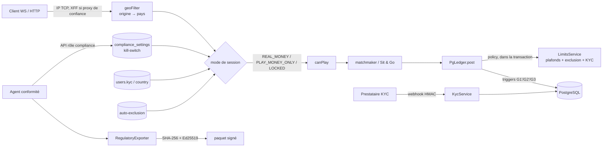

# Sprint 4 — Conformité : KYC, jeu responsable, géo-filtre et kill-switch, export réglementaire

> 26/10/2026 · Périmètre du brief Sprint 4 (h 300–400). Livré et testé sur PostgreSQL 16 réel, sockets et API HTTP réels.
> **276 tests verts** (game-server 217, analyse 43, web 16) · typecheck OK · test de charge sans régression (500 parties, p99 de traitement d'un coup = 0,85 ms).

## 0. ⚠ Cadre juridique : ce que ce code est, et ce qu'il n'est pas

- **Il n'existe pas aujourd'hui de « cadre Skill Gaming » ANJ.** L'ANJ agrée seulement trois activités en ligne : les paris sportifs, les paris hippiques et le poker. Un tournoi d'échecs payant avec gains en argent reste couvert par l'interdiction générale des jeux d'argent (voir ARCHITECTURE.md §6).
- **Le régime expérimental JONUM** (jeux à objets numériques monétisables, loi SREN 2024) **interdit les gains en monnaie ayant cours légal**. Il ne permet donc pas un modèle « buy-in en euros, gains en euros ».
- Ce sprint implémente donc **les obligations des opérateurs en ligne agréés par l'ANJ** comme référentiel de conformité, par choix de prudence. Ce sont celles qu'un régulateur ou un PSP spécialisé jeux exigera :
  - limites de dépôt et de mise obligatoires ;
  - baisse d'une limite immédiate, hausse différée ;
  - auto-exclusion ;
  - KYC 18+ ;
  - géolocalisation ;
  - traçabilité.
- L'argent réel reste **fermé par défaut**, à trois niveaux : la variable d'environnement, la consigne en base livrée fermée par la migration, et la géolocalisation.
- **Un avis d'avocat spécialisé est nécessaire avant d'ouvrir un pays.** Les valeurs réglementaires (délais, bornes) sont des constantes nommées dans `fairplay/limits.ts` et `auth/kyc.ts` : elles s'ajustent sans toucher à la logique.

## 1. Architecture



**Défense en profondeur** : chaque règle est vérifiée là où elle ne peut pas être contournée.

| Règle | Pré-contrôle (message clair) | Contrôle qui fait foi |
|---|---|---|
| Juridiction, kill-switch | `canPlay` (mode de session) | relecture du kill-switch à chaque mise EUR ; coupure → files vidées, Sit & Go annulés |
| Limites de mise, de dépôt | `limitsPrecheck` à `queue:join` / `sng:register` | `LimitsService.ledgerPolicy` **dans la transaction SERIALIZABLE** qui débite |
| Auto-exclusion | mode `LOCKED` | politique du ledger (dépôts et mises) |
| KYC | `canPlay`, `WithdrawalService.request` | triggers SQL : dépôt (G3), paiement (G1'), statut `sent` (G2') |

## 2. Livrables

| Module | Fichier | Points clés |
|---|---|---|
| KYC | `src/auth/kyc.ts` | Machine d'états `UNVERIFIED → PENDING → VERIFIED / REJECTED`, sans raccourci. Âge révolu calculé au jour près (29 février inclus) ; mineur → rejet définitif. Alerte sanctions ou PEP → reste PENDING en revue humaine, motif obligatoire. 3 tentatives au plus. Webhook signé HMAC-SHA256 : horodatage, tolérance de 5 min, comparaison à temps constant, anti-rejeu par `provider_event_id` unique. Journal `kyc_events` immuable. |
| Jeu responsable | `src/fairplay/limits.ts` | Limites `deposit_week`, `stake_week` (7 jours glissants) et `stake_per_entry`. **Limite exigée avant le 1er dépôt ou la 1re mise** (`LIMITS_REQUIRED`). Baisse immédiate, hausse effective après 48 h. Auto-exclusion de 24 h à 12 mois, ou définitive (le compte est alors clôturé) ; une exclusion ne peut jamais être raccourcie. Le solde reste toujours retirable. |
| Branchement ledger | `src/settlement/ledger.ts` (`policy`) | Hook appelé dans `postWithin` après le dédoublonnage et avant l'écriture. Il verrouille les lignes `users` et `rg_limits` des joueurs concernés, triées pour éviter les interblocages. Un rejeu idempotent n'est pas recompté. |
| Dépôts | `src/settlement/deposits.ts` | Montant 5 € – 10 000 € ; référence PSP validée ; idempotent par référence. |
| Retraits | `src/settlement/withdrawals.ts` | KYC exigé à la demande **et** à l'exécution. Une revérification retient les retraits ; ils sont relâchés automatiquement après approbation. |
| Géo-filtre | `src/net/geoFilter.ts` | IPv4 et IPv6 (y compris IPv4-mappée). Base CIDR → pays avec recherche dichotomique (100 000 recherches sur 50 000 blocs en < 500 ms). Anti-usurpation de `X-Forwarded-For` : en-tête lu seulement depuis un proxy déclaré, en partant de la droite. En-tête pays de l'edge (`cf-ipcountry`) accepté seulement via proxy, Tor ou `XX` traités comme inconnus. **Fail closed** : pays inconnu ou erreur de lecture → pas d'argent réel. |
| Kill-switch | `src/net/geoFilter.ts` (`KillSwitch`), `src/app.ts` | Consigne en base, croisée avec le plafond d'environnement : un back-office compromis ne peut pas ouvrir un pays non déployé. Motif obligatoire. Événement immuable et entrée dans la chaîne d'audit. **Propagation entre instances en ≤ 2 s.** |
| Export réglementaire | `src/audit/regulatoryExport.ts`, `scripts/regulatory-export.ts` | 7 sections (dépôts, retraits, rake, KYC, jeu responsable, fair-play, kill-switch), chacune en JSON canonique et en CSV. Lecture dans un instantané `REPEATABLE READ`. Manifeste : SHA-256 par fichier, totaux, tête de la chaîne d'audit vérifiée, équilibre du ledger EUR. Signature **Ed25519** ; une clé est exigée en production (clé éphémère signalée en dev). Neutralisation des formules CSV (OWASP). Registre `regulatory_exports` immuable. Vérification hors ligne avec l'empreinte de la clé de confiance. |
| API | `src/http/api.ts` | Routes joueur (`/account/*`, `/kyc/*`, `/wallet/*`), conformité (`/admin/compliance/*`) et webhook KYC. En-têtes durcis (CSP `default-src 'none'`, `nosniff`, `DENY`, HSTS en production). JSON strict avec `Content-Type` imposé, corps ≤ 16 Ko. Limitation de débit par IP réelle. Erreurs sans détail interne. |
| Front | `apps/web` | Événement `session:mode` → bandeau (argent réel coupé, juridiction, auto-exclusion) ; nouveaux codes d'erreur traduits. |
| Schéma | `db/migrations/003_compliance.sql` | `kyc_events`, `rg_limits`, `rg_events`, `compliance_settings`, `compliance_events` et `regulatory_exports`, les journaux étant immuables. Garde-fous G1' (paiement), G2' (retrait) et G3 (dépôt : KYC vérifié et compte ouvert). Index des fenêtres glissantes. |

### Matrice du mode de session

| Condition (dans l'ordre) | Mode | Effet |
|---|---|---|
| auto-exclu (temporaire ou définitif) | `LOCKED` | aucun jeu, **même PLAY** ; consultation et retraits |
| kill-switch OFF (base ou `REAL_MONEY_ENABLED=0`) | `PLAY_MONEY_ONLY` · `REAL_MONEY_DISABLED` | jetons uniquement ; dépôts refusés |
| pays IP inconnu | `PLAY_MONEY_ONLY` · `UNKNOWN_LOCATION` | idem |
| pays IP ∉ pays autorisés effectifs | `PLAY_MONEY_ONLY` · `JURISDICTION_BLOCKED` | idem |
| résidence KYC connue ∉ pays autorisés | `PLAY_MONEY_ONLY` · `RESIDENCE_BLOCKED` | idem |
| sinon | `REAL_MONEY` | mises EUR si KYC vérifié et limites respectées |

**Les retraits ne sont jamais géo-filtrés** : un joueur en voyage, ou après une coupure, récupère toujours son solde. Le KYC, le solde et les garde-fous comptables restent exigés.

### Coupure du kill-switch, en une transaction logique

1. Toutes les sessions sont réévaluées et reçoivent `session:mode`.
2. Les tickets EUR en file sont retirés (`queue:left`).
3. Les Sit & Go EUR **en inscription** sont annulés et remboursés intégralement, sans rake, et une nouvelle table est ouverte.
4. Les parties et tournois **déjà commencés vont à leur terme** : les interrompre léserait des joueurs engagés de bonne foi, et le règlement reste soumis aux garde-fous.
5. Toute nouvelle mise EUR et tout dépôt sont refusés ; les retraits restent possibles.

## 3. Tests (Sprint 4)

| Suite | Tests | Ce qui est prouvé |
|---|---|---|
| `test/db/limits.pg.test.ts` | 16 | Dépôt au-delà du plafond **rejeté, rien crédité**. **10 dépôts concurrents de 30 € sous un plafond de 100 € → exactement 3 passent**. Fenêtre glissante. Hausse refusée à 47 h 59, appliquée à 48 h 01. Duel : si un joueur dépasse sa limite, **personne n'est débité**. Inscription à un Sit & Go EUR refusée et place libérée. Auto-exclusion temporaire, définitive, et cumulée avec WITHDRAWAL_HOLD. Ledger équilibré. |
| `test/db/kyc.pg.test.ts` | 10 | Transitions, âge, sanctions et PEP, HMAC, rejeu, mineur verrouillé, tentatives limitées. Dépôt sans KYC bloqué par le trigger SQL ; retrait retenu pendant une revérification puis relâché. |
| `test/db/killswitch.pg.test.ts` | 9 | Malte → `REAL_MONEY` ; US → bloqué ; IP inconnue → bloquée ; résidence hors liste → bloquée. Dépôt refusé hors juridiction, retrait accepté. `LIMIT_EXCEEDED` dès l'entrée en file. Auto-exclu → `LOCKED`. **Coupure via l'API → sessions notifiées, file vidée, Sit & Go remboursé au centime, mises EUR refusées, PLAY possible, retrait possible, trace immuable et auditée. Bascule faite par une autre instance appliquée en ≤ 2 s.** Un XFF forgé sans proxy de confiance n'ouvre rien. |
| `test/db/regulatoryExport.pg.test.ts` | 11 | Totaux exacts par section. Formule CSV neutralisée (identifiant `=1+cmd\|calc!A1`). **Falsification détectée** : un octet d'un CSV, un total du manifeste, un fichier retiré ou ajouté, re-signature par une autre clé. Bornes de période. Refus en production sans clé. Registre immuable. Relecture depuis le disque. API réservée au rôle conformité. Webhook KYC HMAC de bout en bout. |
| `src/net/geoFilter.test.ts` | 18 | Analyse IP et CIDR, résolveur, anti-usurpation, matrice de décision, kill-switch (intersection avec l'environnement, motif, notification). |
| `test/db/api.pg.test.ts` | +3 | Limites via l'API (415 / 400 / set / decrease / increase à +48 h), `KYC_REQUIRED`, 429 avec `Retry-After`. |
| `src/auth.test.ts` | 4 | `canPlay` piloté par le mode de session ; l'auto-exclusion bloque aussi PLAY. |

## 4. Exploitation

```bash
# clé de signature des exports (à conserver dans un coffre ; publier l'empreinte au régulateur)
openssl genpkey -algorithm ed25519 -out ed25519.pem

# ouvrir un pays (après avis juridique) — REAL_MONEY_COUNTRIES doit déjà le contenir
curl -X POST $API/admin/compliance/kill-switch -H "authorization: Bearer $JWT_COMPLIANCE" \
  -H 'content-type: application/json' -d '{"enabled":true,"countries":["MT"],"reason":"avis juridique ref. 2026-41"}'

# couper immédiatement (incident PSP, injonction, faille)
curl -X POST … -d '{"enabled":false,"reason":"incident PSP"}'

# export mensuel signé, puis vérification côté auditeur
npm run export:regulatory -w @chessarena/game-server -- --from 2026-10-01 --to 2026-11-01 --out ./exports/2026-10 --by agent-42
npm run export:regulatory -w @chessarena/game-server -- --verify ./exports/2026-10 --fingerprint <sha256>
```

Nouvelles variables : `TRUSTED_PROXIES`, `GEOIP_CSV_PATH`, `EDGE_COUNTRY_HEADER`, `KYC_WEBHOOK_SECRET` et `EXPORT_SIGNING_KEY` (voir README). En production avec l'argent réel, `loadConfig` **refuse de démarrer** dans quatre cas :
- pas de `DATABASE_URL` ;
- `KYC_WEBHOOK_SECRET` de moins de 32 caractères ;
- pas de clé de signature ;
- pas de source de géolocalisation.

## 5. Limites connues et suite

- **Prestataires réels non branchés** : KYC (sandbox derrière l'interface `KycProvider`) et PSP (dépôts sandbox, désactivés en production : un dépôt n'y sera crédité que par un webhook PSP signé, à écrire avec le prestataire choisi).
- **Base GeoIP non fournie** (licence MaxMind). Il faut fournir un CSV `network,country_iso_code` ou un en-tête pays d'edge. Les VPN et proxys résidentiels ne sont pas détectés : prévoir un service de réputation IP. Le croisement IP × résidence KYC limite déjà le contournement.
- **Limites de pertes nettes** non implémentées : les mises brutes sont plafonnées, ce qui est plus strict. Pas de délai de réflexion après une auto-exclusion temporaire : à faire valider.
- **Prévu au plan initial et non couvert par ce brief** : OpenTelemetry / Grafana, et l'automatisation du rapprochement quotidien. `reconcile()` existe et l'export vérifie l'équilibre EUR ; reste à le planifier.
- La limitation de débit HTTP est par processus : derrière plusieurs instances, la doubler d'un limiteur à l'edge ou dans Redis.

## Sources

- ANJ — fiche « Les limites de jeu sur les sites en ligne » : https://www.anj.fr/sites/default/files/2020-01/Les%20limites%20de%20jeu%20sur%20les%20sites%20en%20ligne.pdf
- Ordonnance n° 2019-1015 du 2 octobre 2019 (réforme de la régulation des jeux d'argent, création de l'ANJ) : https://www.legifrance.gouv.fr/jorf/id/JORFSCTA000039167505
- ANJ — lancement du cadre expérimental JONUM : https://anj.fr/launch-jonum-regulatory-framework-trial
- Squire Patton Boggs — « Le régime expérimental des JONUM » : https://larevue.squirepattonboggs.com/le-regime-experimental-des-jonum-jeux-a-objet-numeriques-monetisables.html
- OWASP — CSV Injection : https://owasp.org/www-community/attacks/CSV_Injection
